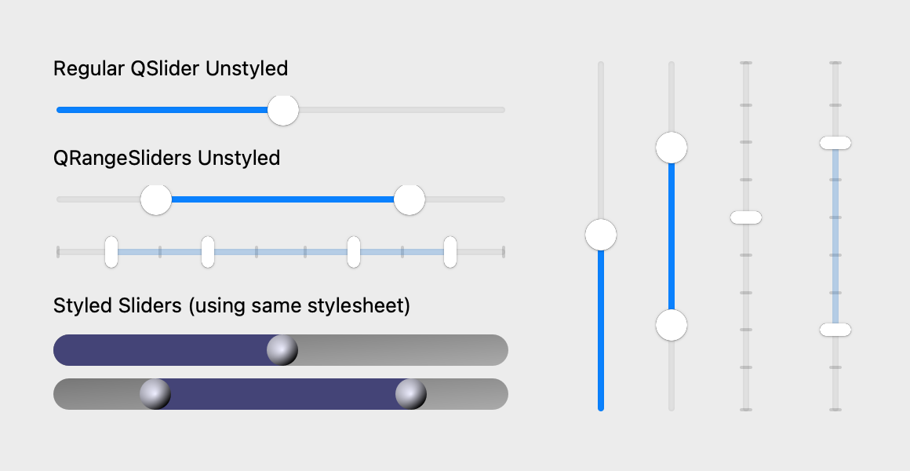
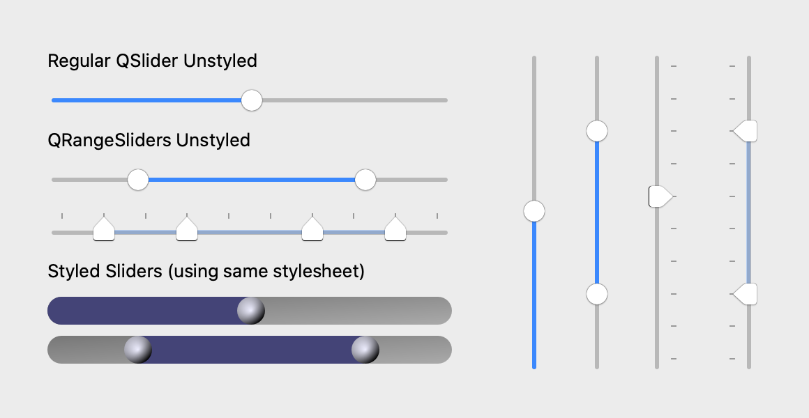
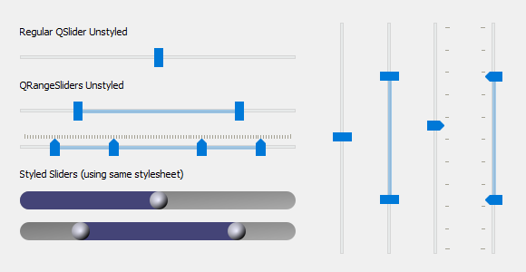
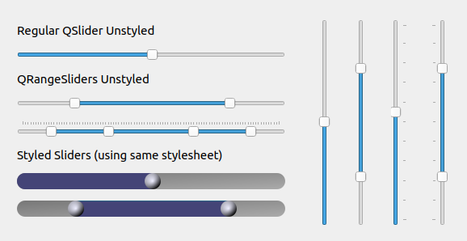

# QRangeSlider

A slider with two or more handles, to select a range of values.

{{ show_widget() }}

```python
--8<--
examples/qrangeslider.py
--8<--
```

`QRangeSlider` is a [`QSlider`](https://doc.qt.io/qt-6/qslider.html), and
has the same API, except that `value()` and `sliderPosition()` are tuples with
one `int` for each handle (see [type changes](#type-changes)):

- The number of handles is the length of the value:
  `slider.setValue([0, 10, 60, 80])` makes four.
- Handles can be dragged, and so can the bar between the outer handles, which
  moves all of them. The mouse wheel also moves all of them (with ++alt++ held,
  it spreads them apart or brings them together).
- The handles, groove, and ticks are drawn with the platform's style, and can be
  styled with Qt style sheets (QSS). The color of the bar is the `barColor`
  property (`qproperty-barColor` in QSS).

These methods, in addition to those of `QSlider`, control the bar between the
handles:

| Getter               | Setter                                     | Default | Description                                                                         |
| -------------------- | ------------------------------------------ | ------- | ----------------------------------------------------------------------------------- |
| `barIsVisible`       | `setBarVisible` <br>`hideBar` / `showBar` | `True`  | Whether the bar between the handles is shown.                                       |
| `barMovesAllHandles` | `setBarMovesAllHandles`                    | `True`  | Whether clicking on the bar moves all handles, or only the nearest one.             |
| `barIsRigid`         | `setBarIsRigid`                            | `True`  | Whether the bar keeps its length when it's dragged against the minimum or maximum. |

### Native styles

`QRangeSlider` and `QSlider`, unstyled and with the same style sheet, on each
platform:

??? example "Code for these screenshots"

    ```python
    import os

    from qtpy import QtCore
    from qtpy import QtWidgets as QtW

    # patch for Qt 5.15 on macos >= 12
    os.environ["USE_MAC_SLIDER_PATCH"] = "1"

    from superqt import QRangeSlider  # noqa

    QSS = """
    QSlider {
        min-height: 20px;
    }

    QSlider::groove:horizontal {
        border: 0px;
        background: qlineargradient(x1:0, y1:0, x2:1, y2:1, stop:0 #888, stop:1 #ddd);
        height: 20px;
        border-radius: 10px;
    }

    QSlider::handle {
        background: qradialgradient(cx:0, cy:0, radius: 1.2, fx:0.35,
                                    fy:0.3, stop:0 #eef, stop:1 #002);
        height: 20px;
        width: 20px;
        border-radius: 10px;
    }

    QSlider::sub-page:horizontal {
        background: qlineargradient(x1:0, y1:0, x2:1, y2:1, stop:0 #227, stop:1 #77a);
        border-top-left-radius: 10px;
        border-bottom-left-radius: 10px;
    }

    QRangeSlider {
        qproperty-barColor: qlineargradient(x1:0, y1:0, x2:1, y2:1, stop:0 #227, stop:1 #77a);
    }
    """

    Horizontal = QtCore.Qt.Orientation.Horizontal


    class DemoWidget(QtW.QWidget):
        def __init__(self) -> None:
            super().__init__()

            reg_hslider = QtW.QSlider(Horizontal)
            reg_hslider.setValue(50)
            range_hslider = QRangeSlider(Horizontal)
            range_hslider.setValue((20, 80))
            multi_range_hslider = QRangeSlider(Horizontal)
            multi_range_hslider.setValue((11, 33, 66, 88))
            multi_range_hslider.setTickPosition(QtW.QSlider.TickPosition.TicksAbove)

            styled_reg_hslider = QtW.QSlider(Horizontal)
            styled_reg_hslider.setValue(50)
            styled_reg_hslider.setStyleSheet(QSS)
            styled_range_hslider = QRangeSlider(Horizontal)
            styled_range_hslider.setValue((20, 80))
            styled_range_hslider.setStyleSheet(QSS)

            reg_vslider = QtW.QSlider(QtCore.Qt.Orientation.Vertical)
            reg_vslider.setValue(50)
            range_vslider = QRangeSlider(QtCore.Qt.Orientation.Vertical)
            range_vslider.setValue((22, 77))

            tick_vslider = QtW.QSlider(QtCore.Qt.Orientation.Vertical)
            tick_vslider.setValue(55)
            tick_vslider.setTickPosition(QtW.QSlider.TicksRight)
            range_tick_vslider = QRangeSlider(QtCore.Qt.Orientation.Vertical)
            range_tick_vslider.setValue((22, 77))
            range_tick_vslider.setTickPosition(QtW.QSlider.TicksLeft)

            szp = QtW.QSizePolicy.Maximum
            left = QtW.QWidget()
            left.setLayout(QtW.QVBoxLayout())
            left.setContentsMargins(2, 2, 2, 2)
            label1 = QtW.QLabel("Regular QSlider Unstyled")
            label2 = QtW.QLabel("QRangeSliders Unstyled")
            label3 = QtW.QLabel("Styled Sliders (using same stylesheet)")
            label1.setSizePolicy(szp, szp)
            label2.setSizePolicy(szp, szp)
            label3.setSizePolicy(szp, szp)
            left.layout().addWidget(label1)
            left.layout().addWidget(reg_hslider)
            left.layout().addWidget(label2)
            left.layout().addWidget(range_hslider)
            left.layout().addWidget(multi_range_hslider)
            left.layout().addWidget(label3)
            left.layout().addWidget(styled_reg_hslider)
            left.layout().addWidget(styled_range_hslider)

            right = QtW.QWidget()
            right.setLayout(QtW.QHBoxLayout())
            right.setContentsMargins(15, 5, 5, 0)
            right.layout().setSpacing(30)
            right.layout().addWidget(reg_vslider)
            right.layout().addWidget(range_vslider)
            right.layout().addWidget(tick_vslider)
            right.layout().addWidget(range_tick_vslider)

            self.setLayout(QtW.QHBoxLayout())
            self.layout().addWidget(left)
            self.layout().addWidget(right)
            self.setGeometry(600, 300, 580, 300)
            self.activateWindow()
            self.show()


    if __name__ == "__main__":
        import sys
        from pathlib import Path

        dest = Path("screenshots")
        dest.mkdir(exist_ok=True)

        app = QtW.QApplication([])
        demo = DemoWidget()

        if "-snap" in sys.argv:
            import platform

            QtW.QApplication.processEvents()
            demo.grab().save(str(dest / f"demo_{platform.system().lower()}.png"))
        else:
            app.exec_()
    ```

=== "macOS (Big Sur)"

    { width=580 }

=== "macOS (Catalina)"

    { width=580 }

=== "Windows"

    { width=580 }

=== "Linux"

    { width=580 }

{{ show_members('superqt.QRangeSlider') }}

## Type changes

Compared with `QSlider`, these methods and signals take or return one value
for each handle:

```python
value() -> tuple[int, ...]
setValue(val: Sequence[int]) -> None
sliderPosition() -> tuple[int, ...]
setSliderPosition(val: Sequence[int]) -> None

# signals
valueChanged(tuple[int, ...])  # (also available as `valuesChanged`)
sliderMoved(tuple[int, ...])  # (also available as `slidersMoved`)
```
